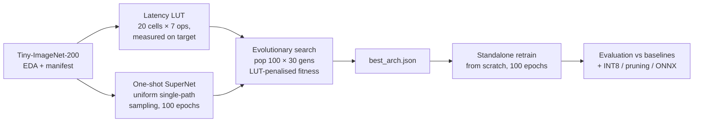

# Adaptive Edge NAS: Hardware-Aware Neural Architecture Search for Edge Devices

> 🏆 **2nd Position at the 9th IFIP International Internet of Things (IoT) Conference**, United Arab Emirates University (UAEU), Al Ain, UAE.
> Paper: *"Hardware-Aware One-Shot NAS for Lightweight CNNs: A Latency-Constrained Evolutionary Search on Tiny-ImageNet"*. See [Publication](#publication).

This repository holds the full pipeline for a **latency-constrained, hardware-aware Neural Architecture Search (NAS)** on **Tiny-ImageNet-200**. A one-shot weight-sharing SuperNet is trained once. An evolutionary search guided by a **measured per-operation latency lookup table (LUT)** then picks an architecture under a 10 ms budget. That architecture is retrained from scratch, compared with hand-designed mobile CNNs, and compressed for deployment (INT8 quantization, pruning, ONNX).

**Headline result:** the NAS-found network reaches **46.40 % top-1** with **1.98 M parameters**. That is within about 1 point of EfficientNet-B0 (47.47 %), with **54 % fewer parameters**, a **54 % smaller model file**, **30 % lower PyTorch latency** and **2.2× faster ONNX Runtime inference**.

---

## Contents

- [Results](#results)
- [Method](#method)
- [Discovered architecture](#discovered-architecture)
- [Experimental setup](#experimental-setup)
- [Reproducing the pipeline](#reproducing-the-pipeline)
- [Repository structure](#repository-structure)
- [Notes and limitations](#notes-and-limitations)
- [Publication](#publication)

---

## Results

All four models were trained with the same recipe and evaluated by the same script (`evaluation.py`) on the 10,000-image Tiny-ImageNet validation set. Latency is the median of 100 runs at batch size 1 on a 64×64 input, after 10 warm-up runs.

| Model | Top-1 (%) | Top-5 (%) | Params (M) | FLOPs (M) | PyTorch latency (ms) | ONNX Runtime latency (ms) | Size (MB) |
|---|---:|---:|---:|---:|---:|---:|---:|
| ShuffleNetV2 1.0× | 38.31 | 64.74 | 1.459 | 49.7 | 9.24 | 3.96 | 5.7 |
| MobileNetV2 | 43.71 | 69.27 | 2.480 | 106.8 | **7.25** | **2.66** | 9.7 |
| EfficientNet-B0 | **47.47** | **72.44** | 4.264 | 135.8 | 11.38 | 9.28 | 16.6 |
| **NAS-Found (ours)** | 46.40 | 71.49 | 1.975 | 193.7 | 7.99 | 4.15 | 7.7 |

<sub>Source: [`results/final_comparison.json`](experiments/tiny-imagenet/results/final_comparison.json). Measured on an NVIDIA Tesla V100-SXM2-32GB.</sub>

### Key findings

- **Compared with EfficientNet-B0** (the most accurate baseline): top-1 is 1.07 points lower, while the network has **53.7 % fewer parameters**, a **53.6 % smaller** checkpoint, **29.8 % lower** PyTorch latency (7.99 vs 11.38 ms) and **2.24× faster** ONNX Runtime inference (4.15 vs 9.28 ms).
- **Compared with MobileNetV2**: **+2.69 points top-1** with 20 % fewer parameters, at 0.74 ms more PyTorch latency.
- **Compared with ShuffleNetV2**: **+8.09 points top-1** and 13.5 % lower PyTorch latency.
- **FLOPs are not latency.** The NAS model has the *highest* FLOP count (193.7 M) but runs faster than EfficientNet-B0 (135.8 M) and ShuffleNetV2 (49.7 M). Proxies such as FLOPs or parameter counts mislead on real hardware. This is why the search uses a measured latency LUT instead.

<p align="center">
  
  
</p>
<p align="center">
  
</p>

---

## Method



### 1. Search space

The network is a fixed macro-skeleton of **20 searchable cells** between a 3×3 stem and a classification head. Every cell picks one of **7 candidate operations**, which gives **7²⁰ ≈ 7.98 × 10¹⁶** candidate architectures.

| ID | Operation | Description |
|---|---|---|
| 0 | `identity` | Skip connection (a 1×1 conv + BN adapter when shape changes) |
| 1 | `dwconv3x3` | Depthwise-separable conv, 3×3 |
| 2 | `dwconv5x5` | Depthwise-separable conv, 5×5 |
| 3 | `mbconv3x3` | Inverted residual (MBConv), expansion 3, 3×3 |
| 4 | `mbconv5x5` | Inverted residual (MBConv), expansion 3, 5×5 |
| 5 | `shuffle_block` | ShuffleNetV2 unit (channel split + channel shuffle) |
| 6 | `se_block` | Depthwise + pointwise conv with Squeeze-and-Excitation |

Macro-skeleton for a 64×64 input:

| Stage | Cells | Output channels | Resolution | Downsample at |
|---|---|---:|---:|---|
| Stem | — | 32 | 64×64 | — (stride 1) |
| 1 | 0–1 | 32 | 64×64 | — |
| 2 | 2–4 | 64 | 32×32 | cell 2 |
| 3 | 5–9 | 128 | 16×16 | cell 5 |
| 4 | 10–13 | 192 | 8×8 | cell 10 |
| 5 | 14–19 | 256 | 4×4 | cell 14 |
| Head | — | 200 | — | GAP → Dropout(0.2) → FC |

### 2. Hardware latency lookup table

Each `(cell, op)` pair is built standalone, at the exact input channel count and spatial size it sees inside the network. It is timed at batch size 1: 10 warm-up runs, then the median of 50 runs. The predicted latency of an architecture is the sum of its 20 LUT entries:

```math
\widehat{\mathrm{LAT}}(a) = \sum_{i=1}^{20} \mathrm{LUT}\left[i,\; a_i\right]
```

This makes latency prediction for a candidate O(1) with no hardware in the loop. The table is saved as [`results/latency_lut.json`](experiments/tiny-imagenet/results/latency_lut.json). Predicted latencies in the space range from 0.83 ms to 10.99 ms.

### 3. One-shot SuperNet training

All 7 operations of every cell live side by side in a single SuperNet with shared weights. At each training step one path is sampled uniformly at random and only that path is trained (single-path one-shot NAS). This decouples weight training from the search, so thousands of candidates can be ranked without training each one.

- 100 epochs, AdamW (lr 2e-3, weight decay 1e-4), 5-epoch linear warm-up then cosine decay, label smoothing 0.1, AMP, gradient clipping at 5.0.

### 4. Latency-constrained evolutionary search

Each candidate is scored with SuperNet weights on the full validation set. Its fitness combines that accuracy with the LUT latency:

```math
F(a) = \begin{cases}
\mathrm{Acc}(a) & \text{if } \widehat{\mathrm{LAT}}(a) \le B \\
\mathrm{Acc}(a) - 0.5 \cdot \dfrac{\widehat{\mathrm{LAT}}(a) - B}{B} & \text{otherwise}
\end{cases}
\qquad B = 10\ \mathrm{ms}
```

| Setting | Value |
|---|---|
| Population / generations | 100 / 30 |
| Elitism | top 20 carried over |
| Parent selection | tournament, k = 3 |
| Crossover | single-point |
| Mutation | per-gene, p = 0.2 |
| Unique architectures evaluated | **2,416** |

The final architecture is the most accurate candidate inside the budget. Its predicted latency is 7.47 ms.

<p align="center">
  
</p>

> SuperNet accuracies (≈ 0.4–5.4 % in the plot above) come from shared weights and a single sampled path. They serve **only as a ranking signal** between candidates. Real accuracy comes from retraining the chosen architecture from scratch (step 5).

### 5. Standalone retraining

The chosen architecture is built as a lean static network (`StandaloneNASModel`) with no SuperNet overhead. It is then trained from scratch with the same recipe as the baselines (see [Experimental setup](#experimental-setup)).

### 6. Deployment-oriented post-processing

Each trained model goes through `evaluation.py`, which applies:

- **Post-training dynamic INT8 quantization** (`torch.quantization.quantize_dynamic`)
- **Global L1 unstructured magnitude pruning** at 30 % sparsity on all Conv2d weights
- **ONNX export** (opset 18, dynamic batch) and latency benchmarking with **ONNX Runtime**

---

## Discovered architecture

[`results/best_arch.json`](experiments/tiny-imagenet/results/best_arch.json) stores the architecture as `[4, 5, 2, 3, 5, 3, 5, 0, 4, 5, 2, 3, 6, 4, 3, 2, 0, 3, 0, 4]`:

| Stage | Res. | Ch. | Selected operations (↓ = stride-2 cell) |
|---|---:|---:|---|
| 1 | 64² | 32 | MBConv5×5 → Shuffle |
| 2 | 32² | 64 | DWConv5×5↓ → MBConv3×3 → Shuffle |
| 3 | 16² | 128 | MBConv3×3↓ → Shuffle → Identity → MBConv5×5 → Shuffle |
| 4 | 8² | 192 | DWConv5×5↓ → MBConv3×3 → SE → MBConv5×5 |
| 5 | 4² | 256 | MBConv3×3↓ → DWConv5×5 → Identity → MBConv3×3 → Identity → MBConv5×5 |

Patterns in the result:

- **MBConv dominates**, with 9 of 20 cells (5 × 3×3 and 4 × 5×5). It is the main source of representational capacity.
- **ShuffleNet units** fill 4 cells, all in the high-resolution stages 1–3. There they give cheap channel mixing.
- **The search drops depth with skips.** It places 3 identity cells, all in the deeper stages 3 and 5, and none at a downsampling cell.
- **Large receptive fields are kept.** Both downsampling cells that use a depthwise-separable conv choose the 5×5 kernel.

---

## Experimental setup

| | |
|---|---|
| Dataset | Tiny-ImageNet-200: 200 classes, 100,000 train / 10,000 val images, 64×64 RGB |
| Data integrity | 500 train and 50 val images per class (perfectly balanced), 0 corrupt images in a 2,000-image sample |
| Normalisation | Measured RGB mean (0.4846, 0.4510, 0.4010), std (0.2767, 0.2686, 0.2817) |
| Train augmentation | RandomCrop(64, pad 8, reflect), HFlip, ColorJitter(0.3, 0.3, 0.3, 0.1), RandomGrayscale(0.05), RandomErasing(0.2) |
| Batch-level augmentation | Mixup (α = 0.2) or CutMix (α = 1.0), 50/50 per batch |
| Optimiser | AdamW, lr 3e-3, weight decay 5e-4, batch size 256 |
| Schedule | 100 epochs, 5-epoch linear warm-up, then cosine to 1e-6; early stopping with patience 25 |
| Regularisation | Label smoothing 0.1, gradient clipping at 5.0 |
| Throughput tricks | AMP (fp16), `channels_last`, `torch.compile`, TF32, cuDNN benchmark |
| Baselines | torchvision MobileNetV2, ShuffleNetV2 1.0×, EfficientNet-B0. All trained from scratch, with the stem stride set to 1 for 64×64 inputs |
| Hardware | NVIDIA Tesla V100-SXM2-32GB (DGX) |
| Seed | 42 |

<p align="center">
  
</p>

---

## Reproducing the pipeline

### 1. Install dependencies

Python 3.11+ is required, since the scripts use `torch.compile`.

```bash
pip install torch torchvision onnx onnxruntime thop matplotlib numpy pillow
```

`thop` is optional and only used for FLOPs counting. `onnxruntime-gpu` can replace `onnxruntime` to benchmark on CUDA.

### 2. Get the dataset

```bash
wget http://cs231n.stanford.edu/tiny-imagenet-200.zip
```

```bash
unzip tiny-imagenet-200.zip
```

Next, open `eda.py`, `data-processing.py` and `model-training.py` and set `DATASET_DIR` to the extracted folder. It is currently hard-coded to the original cluster path. The later scripts read the dataset from the manifest that `data-processing.py` writes.

### 3. Run the six phases in order

Run every phase from the `experiments/tiny-imagenet/` directory. The scripts resolve `results/`, `models/` and `processed/` relative to it.

```bash
cd experiments/tiny-imagenet
```

```bash
python scripts/eda.py              # 1. integrity checks, RGB stats  -> results/dataset_stats.json
python scripts/data-processing.py  # 2. augmentation + manifest       -> processed/data_manifest.pkl
python scripts/model-training.py   # 3. train the three baselines     -> models/<name>_best.pth
python scripts/hardware-aware.py   # 4. LUT + SuperNet + evolution    -> results/best_arch.json
python scripts/nas.py              # 5. retrain the found architecture -> models/nas_best_finetuned.pth
python scripts/evaluation.py       # 6. benchmark, quantize, prune, ONNX -> results/final_comparison.json
```

The three training scripts (`model-training.py`, `hardware-aware.py`, `nas.py`) have a `DRY_RUN` flag near the top. It runs a few batches per epoch for a quick end-to-end smoke test. Phases 3 and 4 skip work whose outputs already exist (baseline checkpoints, the LUT, the SuperNet checkpoint), so an interrupted run can be resumed.

> **Latency is hardware-specific.** To target a different edge device (for example a Jetson, Raspberry Pi or mobile CPU), delete `results/latency_lut.json` and run `hardware-aware.py` **on that device**. The LUT is rebuilt from scratch and the search then optimises for that hardware.

A phase-by-phase description of each script lives in [`experiments/tiny-imagenet/README.md`](experiments/tiny-imagenet/README.md).

---

## Repository structure

```
adaptive-edge-nas/
├── README.md                          ← you are here
└── experiments/tiny-imagenet/
    ├── README.md                      phase-by-phase script guide
    ├── scripts/
    │   ├── eda.py                     1. dataset integrity + statistics
    │   ├── data-processing.py         2. augmentation, manifest, dataloader benchmark
    │   ├── model-training.py          3. MobileNetV2 / ShuffleNetV2 / EfficientNet-B0 baselines
    │   ├── hardware-aware.py          4. latency LUT, one-shot SuperNet, evolutionary search
    │   ├── nas.py                     5. standalone retraining of the found architecture
    │   └── evaluation.py              6. benchmarking, INT8 quantization, pruning, ONNX export
    └── results/                       metrics (JSON) and figures (PNG) from the reported run
        ├── final_comparison.json      ← main results table
        ├── best_arch.json             ← discovered architecture
        ├── latency_lut.json           ← per-(cell, op) latency table
        ├── search_history.json        ← all 2,416 evaluated architectures
        ├── baseline_*_metrics.json    ← per-epoch training histories
        ├── dataset_stats.json, dataloader_benchmark.json
        └── *.png                      ← every figure shown in this README
```

Model checkpoints (`models/`), the processed manifest (`processed/`) and the dataset itself are git-ignored.

---

## Notes and limitations

- **Target hardware.** The reported LUT and latencies were measured on a V100 GPU at batch size 1, standing in for an edge accelerator. Absolute numbers will differ on a real edge device. The method is device-agnostic: rebuild the LUT on the target, as described above.
- **Additive LUT.** Summing per-op latencies ignores fusion and inter-op effects. For the found architecture, the LUT predicted 7.47 ms and end-to-end measurement gave 7.99 ms (about 7 % error).
- **Two latency columns.** The `latency_ms` values in `baseline_*_metrics.json` (about 1.3 ms) were measured on `torch.compile`'d models (`reduce-overhead` mode, CUDA graphs) at the end of training. `final_comparison.json` re-measures every model in eager mode under identical conditions, so use it for comparisons.
- **SuperNet latency term.** The latency penalty added to the SuperNet training loss is a LUT lookup and is constant with respect to the weights, so it does not change gradients. The hardware constraint takes effect in the search fitness.
- **Quantization scope.** PyTorch dynamic quantization covers `nn.Linear` layers. Conv layers stay in fp32, so INT8 gains here are limited to the classifier. Static or QAT quantization would be the next step for conv-heavy edge deployment.

---

## Publication

**Hardware-Aware One-Shot NAS for Lightweight CNNs: A Latency-Constrained Evolutionary Search on Tiny-ImageNet**

Poojan Patel, Krish Nariya, Angajala Gautam Raju, Krishna Sharma

*9th IFIP International Internet of Things (IoT) Conference*, held at the United Arab Emirates University (UAEU), Al Ain, UAE.
🏆 The paper **secured 2nd position** at the conference.

If you use this code or build on the results, please cite the paper:

```bibtex
@inproceedings{adaptive_edge_nas,
  title     = {Hardware-Aware One-Shot {NAS} for Lightweight {CNNs}: A Latency-Constrained Evolutionary Search on {Tiny-ImageNet}},
  author    = {Patel, Poojan and Nariya, Krish and Raju, Angajala Gautam and Sharma, Krishna},
  booktitle = {9th IFIP International Internet of Things (IoT) Conference},
  address   = {United Arab Emirates University (UAEU), Al Ain, UAE},
  note      = {2nd position}
}
```
